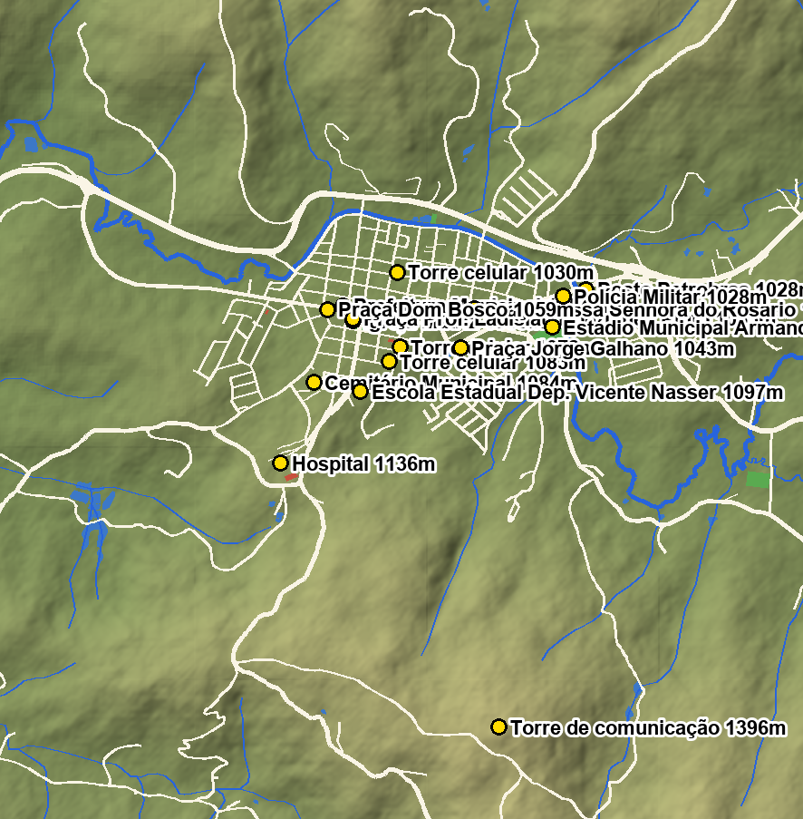
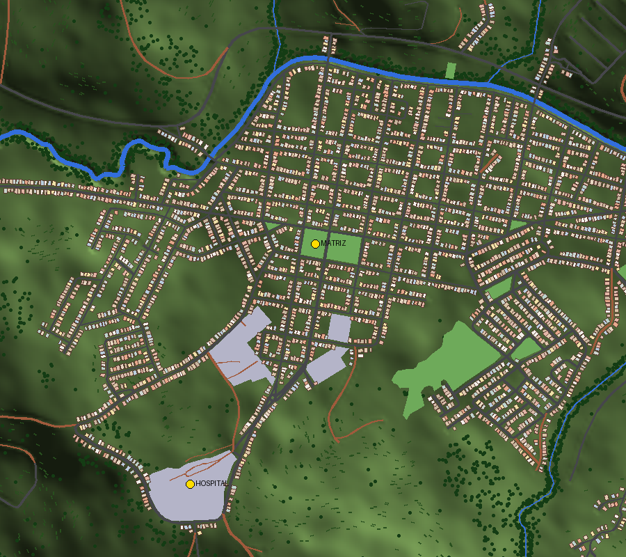

# Divinolândia (SP) — dossiê da cidade real para o jogo

Esta pasta é a **fonte de verdade** da migração da cidade do jogo para **Divinolândia, interior de São Paulo**. Tudo o que o jogo constrói da cidade (relevo, ruas, rio, casas, marcos) sai daqui por um *bake* determinístico (`npm run bake:divinolandia`). A ideia é ir acrescentando material (fotos, medidas, nomes, detalhes) e refinando o mapa aos poucos, sempre o mais fiel possível à cidade real.



---

## 1. A cidade em números (IBGE)

| | |
|---|---|
| Código IBGE | **3513900** |
| Gentílico | divinolandense |
| População (Censo 2022) | **11.158** habitantes |
| População estimada (IBGE, 2026) | 11.296 |
| Área | 223,749 km² |
| Densidade (2022) | 49,87 hab/km² |
| PIB (2023) | R$ 528,6 milhões |
| Altitude da sede | **1.058 m** (21°39'41" S, 46°44'21" O) |
| Ponto mais alto | Morro do Canelá, 1.490 m (bairro Campo Redondo) |
| Distritos | Sede + **Campestrinho**; povoado de Ribeirão do Santo Antônio |
| Região | Microrregião de São João da Boa Vista · Região imediata São José do Rio Pardo–Mococa · Mesorregião de Campinas |
| Aniversário | 30 de dezembro (emancipação em 1953) |
| Título oficial | Município de Interesse Turístico de Divinolândia |
| Economia | Agricultura: **café e batata** |

Dados brutos: [`ibge/dados-ibge.json`](ibge/dados-ibge.json), [`ibge/api-ibge-respostas-brutas.txt`](ibge/api-ibge-respostas-brutas.txt), malha do município [`ibge/malha-municipio.geojson`](ibge/malha-municipio.geojson), histórico oficial [`ibge/historico-ibge-divinolandia.pdf`](ibge/historico-ibge-divinolandia.pdf) (texto em [`textos/historico-ibge.txt`](textos/historico-ibge.txt)).

## 2. História (resumo do histórico do IBGE)

- **1850** — às margens do **Rio do Peixe** (afluente do Rio Pardo), em relevo serrano, é construído um rancho de pernoite para os tropeiros que iam à vila de Casa Branca. Depois de um incêndio, o novo abrigo dá ao lugar o nome de **Pouso do Sapecado**.
- **25/01/1858** — é curada a capela do **Divino Espírito Santo**, origem da Igreja Matriz.
- **1865** — o Major **Thomaz de Andrade** e Mariana Leopoldina da Costa doam o terreno do patrimônio à paróquia; o lugar vira freguesia do *Divino Espírito Santo do Rio do Peixe* (de Caconde). Hoje existe a **Rua Capitão Thomaz de Andrade**.
- **1881** — Joaquim **Pio de Andrade** doa terreno à capela de **Nossa Senhora do Rosário** (hoje Praça Nossa Senhora do Rosário; existe a **Rua Pio de Andrade**).
- **1938** — o distrito passa a se chamar **Sapecado**.
- **30/12/1953** — elevado a município com o nome **Divinolândia**.
- **1959** — criado o distrito de **Campestrinho**.
- O **Hospital Regional** nasceu da luta de dez municípios da região por um sanatório para tuberculosos; o clima de montanha de Divinolândia decidiu a escolha da cidade. Hoje é administrado pelo consórcio **CONDERG** (criado em 1985) e atende 100% SUS.

## 3. Geografia — como a cidade é

- **Serra da Mantiqueira**: relevo acidentado, cidade **íngreme**, cercada de **serras verdes** cobertas de **cafezais** em curva de nível, pasto e mata nas grotas. Geada todo inverno na zona rural.
- **Beira do rio**: a parte baixa da cidade, ao longo do **Rio do Peixe** (que corre de leste para oeste pelo norte do centro). A *Avenida Marginal do Rio do Peixe* e a *Rodovia Lourival Lindório de Faria* seguem o vale.
- **Centro**: quadriculado de ruas subindo do rio em direção ao sul. A **Igreja Matriz do Divino Espírito Santo** (~1.065 m) fica numa praça no meio do centro, com a **Praça Dr. Alcindo Cardoso de Paiva** (a praça do coreto) ao lado. Prefeitura (Rua XV de Novembro), Polícia Civil, Praça Dom Bosco ao redor.
- **Parte de cima**: subindo para o sudoeste, o **Hospital** (~1.136 m), o Cemitério Municipal e a E.E. Dep. Vicente Nasser.
- **Mirante — Morro da Torre** (~1.380–1.396 m): a sudeste, uma torre de telecomunicação bem alta no topo do morro. Dali se vê Divinolândia e São Sebastião da Grama de dia e, à noite, as luzes de Vargem Grande do Sul, São José do Rio Pardo, Tapiratiba, Caconde…

### Marcos com coordenadas e altitude (OSM + SRTM)

| Marco | OSM | Lat, Lon | Altitude |
|---|---|---|---|
| Igreja Matriz (Paróquia do Divino Espírito Santo) | way/542649940 | -21.66209, -46.73932 | 1.065 m |
| Praça Prof. Ladislau Rodrigues Pinto (praça da Matriz) | way/732002964 | -21.66200, -46.73933 | 1.063 m |
| Praça Dr. Alcindo Cardoso de Paiva (coreto) | way/542649936 | -21.66211, -46.73853 | ~1.060 m |
| Prefeitura Municipal | way/543759772 | -21.66143, -46.73981 | 1.054 m |
| Hospital (no OSM: "Hospital Ortopedista de Divinolândia") | way/542649938 | -21.66834, -46.74274 | 1.136 m |
| **Torre do mirante — Morro da Torre** | way/543759751 | -21.67996, -46.73240 | 1.396 m |
| Estádio Municipal Armando Grespan | way/542649859 | -21.66237, -46.72988 | 1.028 m |
| Cemitério Municipal | way/536783868 | -21.66480, -46.74117 | 1.084 m |
| Praça Nossa Senhora do Rosário | way/732002971 | -21.66156, -46.73358 | 1.051 m |
| Praça Jorge Galhano | way/536783873 | -21.66328, -46.73422 | 1.043 m |
| Posto Petrobras (entrada leste) | node/13690275377 | -21.66072, -46.72829 | 1.028 m |
| Polícia Militar | node/13690279160 | -21.66101, -46.72936 | 1.028 m |
| Igreja São Francisco (Igreja Ecológica) | way/543759981 | -21.67316, -46.71617 | 1.064 m |

Lista completa em [`osm/marcos.json`](osm/marcos.json). Nomes das 114 ruas mapeadas: [`textos/ruas-osm.txt`](textos/ruas-osm.txt) (inclui **Rua João Darcie** e **Rua Walter Darcie**).

## 4. Mapas

| Arquivo | O que é |
|---|---|
| [`mapa/centro-urbano.png`](mapa/centro-urbano.png) | Recorte do centro: relevo sombreado + ruas/rios OSM + marcos com altitude |
| [`mapa/visao-geral.jpg`](mapa/visao-geral.jpg) | A área inteira baixada (~12 × 12 km): a cidade e as serras em volta |
| [`relevo/relevo-sombreado.jpg`](relevo/relevo-sombreado.jpg) | Só o relevo (hipsometria + sombreamento) |
| [`mapa/bake-jogo.jpg`](mapa/bake-jogo.jpg), [`mapa/bake-jogo-centro.png`](mapa/bake-jogo-centro.png) | **O que o jogo constrói**: o resultado do bake (casas, ruas, rio, mata, cafezais) visto de cima |



## 5. Fotos

O Wikimedia Commons tem pouquíssimas fotos da cidade com licença livre. Baixadas (créditos e licenças em [`fotos/CREDITOS.json`](fotos/CREDITOS.json)):

| Foto | Autor · licença |
|---|---|
| `divinolandia-cafezal-panoramio.jpg`: morro de cafezal em Divinolândia | Luiz Xavier Estradeiro · CC BY 3.0 |
| `campestrinho-igreja-nsra-fatima.jpg`: igreja N. Sra. de Fátima, Campestrinho | Altemiro Olinto Cristo · CC BY-SA 3.0 |
| `campestrinho-entrada.jpg`: entrada de Campestrinho | Saulo Casagrande · CC BY-SA 3.0 |
| `bandeira-divinolandia.png`, `brasao-divinolandia.png`, `bandeira-grelha-construcao.jpg` | Prefeitura · domínio público |
| `mapa-localizacao-sp.svg`: localização no estado | Raphael Lorenzeto de Abreu · CC BY 2.5 |

> **Precisamos de mais fotos.** O que mais ajuda a deixar o jogo fiel: a Matriz por todos os lados, a praça do coreto, a fachada do Hospital Regional, a torre do mirante e a vista lá de cima, a beira do rio, ruas típicas (subidas, calçamento, fachadas), a entrada da cidade. Fotos próprias podem ir em `fotos/` (só para referência: o jogo **nunca** usa foto como textura, tudo é modelado em código, ver `docs/ART_DIRECTION.md`). A Igreja Matriz do jogo (`src/assets/models/rural/igreja-divino.ts`) já foi modelada a partir de fotos da praça.

## 6. Como o jogo usa isto

```
docs/divinolandia/osm/urbano.json        ┐
docs/divinolandia/relevo/dem-u16.bin.gz  ┴─ tools/bake-divinolandia.ts ─→ src/data/divinolandia.json
                                                                         (carregado sob demanda)
```

- **Escala 1:1**, metros locais centrados na Igreja Matriz (x = leste, z = sul). No mundo do jogo a cidade fica deslocada em (+5000, +5000), longe do mapa clássico.
- **Relevo**: SRTM. Grade jogável de 8 m (3 × 3,3 km), com as serras ao redor numa grade de 48 m (~12 km). Física e visual usam **os mesmos triângulos**.
- O bake **nivela o leito das ruas** (sem carro andando torto na encosta), **cava o Rio do Peixe** num canal estreito sempre descendo (margens no nível da água; onde uma rua cruza, o leito dela fica acima da água, como um bueiro) e **aplaina os terrenos** da Matriz, do hospital e da torre. A largura da água desenhada sai do próprio relevo (`water.ts` acha a margem de cada lado), e ruas/praças são recortadas pelos triângulos do terreno para ficarem coladas nele.
- **Ruas**: todas as 273 vias do OSM: asfalto, **terra roxa** nas estradas de terra, calçada nas ruas do centro e postes.
- **Casas**: o OSM quase não tem prédios mapeados em Divinolândia, então o bake **enfileira casas ao longo das ruas reais** (3.832), só dentro da área urbana do OSM. Ficam de fora ruas, praças, lotes vagos ("L.V"), rios e marcos. São casas térreas e sobrados de cal colorida, telhado de telha ou platibanda, e no centro o térreo vira comércio (porta de aço + toldo).
- **Vegetação**: mata ciliar ao longo de todos os córregos, manchas de mata e **cafezais em curva de nível** nas encostas.
- **Marcos modelados**: Igreja Matriz + coreto + praças, Prefeitura, Hospital Regional, Torre do Mirante com o deck, estádio/campos, cemitério com túmulos, escolas, placa de entrada "DIVINOLÂNDIA · ALT. 1058 m".
- **Postos de combustível** (do Street View + satélite z20/z21, `src/assets/models/divinolandia/posto-*.ts`): Auto Posto Triângulo (Petrobras), Posto Petrobras / Auto Posto Passoni, Posto Lurain e Posto Taurus. Ficam no relevo real do lote (sem terraplenagem).
- **Comércio** (76 supermercados, bancos, farmácias e lojas, cada um a partir da sua foto do Street View): `src/js/world/divinolandia/comercio/lojas.ts` (dados) + `loja-comercio.ts` (fachada + letreiros, toldos, revestimentos). As capturas apontadas para cada lugar saem de `npx tsx tools/capture-streetview.ts --batch <jobs.json>`.
- **Monumento ao Ciclista** (entrada leste, Av. A × SP-344; `monumento-ciclista.ts`): o arco de concreto com os três ciclistas de aço inox e a praça em meia-lua. O satélite com grade em metros sai de `npx tsx tools/capture-satellite.ts <nome> <lat> <lng> [meia-largura]`.
- O HUD mostra o **nome real da rua** onde você está. O radar e o mapa (M) desenham a cidade real.

Para regenerar: `python docs/divinolandia/scripts/fetch-dem.py` (baixa os tiles), `python docs/divinolandia/scripts/render-overview.py` (limpa o relevo, gera mapas e o DEM compacto), `npm run bake:divinolandia` (gera os dados do jogo), `python docs/divinolandia/scripts/render-bake.py` (imagem de conferência). Para atualizar o OSM: `python -I docs/divinolandia/scripts/overpass.py docs/divinolandia/scripts/q-urbano.overpassql docs/divinolandia/osm/urbano.json`.

### Ruas levantadas lote a lote (Street View)

A partir daqui as ruas passam a ser **100% fiéis**, uma de cada vez: cada lote é descrito a partir do Google Street View (cores, número de andares, tipo de telhado, portões, janelas, sacadas, muros, revestimento de pedra, toldos, placas). As capturas ficam em `referencias-streetview/` **só localmente** (imagens do Google, fora do git).

| Rua | Spec | Notas |
|---|---|---|
| **Rua José Augusto Machado** (367 m) | `src/js/world/divinolandia/ruas/jose-augusto-machado.ts` | 46 lotes nos dois lados entre a Manoel Pereira de Souza e a Joaquim Garcia. Asfalto no 1º quarteirão, **paralelepípedo** da Barão do Rio Branco até a Francisco Pereira de Souza, asfalto no último. A **casa rosa da esquina** (nº 228 / R. Francisco Pereira de Souza nº 58) tem modelo próprio (`src/assets/models/divinolandia/casa-rosa-esquina.ts`). Também estão lá a casa verde de grafiato com lambrequim, a casa azul, o sobrado de pedra com hera, a "Faculdade UNINA", a clínica "Letícia Brandi", o terreno da torre de celular, as resedás rosas e as palmeiras. |
| **Rua XV de Novembro** (692 m) | `src/js/world/divinolandia/ruas/xv-de-novembro.ts` | 79 lotes nos dois lados, da ponta oeste até a Lourival de Medeiros, cada um a partir de uma foto do Street View apontada para ele (`xv-N-*`, `xv-S-*`). Paralelepípedo em toda a extensão. Convive com os 30 comércios levantados (`comercio/lojas.ts`), a Prefeitura e as praças, que desenham a própria calçada. |

Paralelepípedo também confirmado nas ruas Barão do Rio Branco, Leonor Mendes de Barros e Francisco Pereira de Souza.

## 7. Roteiro da migração (a cidade inteira do jogo → Divinolândia)

A v1 é **jogável** pelo botão *Divinolândia* na tela inicial (ou `?map=divinolandia`). O mapa clássico continua existindo até tudo migrar.

1. **v1 (agora)**: cidade real, relevo, rio, casas, marcos, carros estacionados (Uno, Kombi), colisão, radar, nome das ruas, renascer no Hospital Regional.
2. **Vida na cidade**: pedestres e trânsito andando pelas ruas reais (o grafo de ruas do OSM já está no bake).
3. **Polícia e procurado**: viaturas saindo da delegacia/PM reais.
4. **Missões e lojas**: telefone público, oficina, loja de armas, casa do jogador etc. em endereços de Divinolândia.
5. **Fidelidade**: rua a rua com o Street View (a Rua José Augusto Machado já está pronta), fachadas reais dos prédios do centro (com fotos), a Matriz com medidas exatas, o Hospital Regional, Campestrinho, as cachoeiras e os outros mirantes.
6. **Virada**: Divinolândia vira o mapa padrão e o mapa clássico sai.

## 8. Fontes e licenças

- **Onde há casa de verdade** (`edificacoes/`): o bake só põe casa gerada onde algum mapa mostra construção — as pegadas de edificações detectadas por ML da **Microsoft Global ML Building Footprints** (licença **ODbL**, <https://github.com/microsoft/GlobalMLBuildingFootprints>; quadkey 210133323, versão 2026-02-03, recortado em `edificacoes/ms-footprints.json`), os prédios desenhados no **mapa do Google Maps**, ou as zonas traçadas à mão sobre o **satélite do Google Maps** onde há casas que nenhum mapa tem ainda (`edificacoes/zonas-construidas.json`, hoje o conjunto habitacional a oeste). Os tiles do Google (mapa z18 + satélite z19) são só referência, fora do git (`scripts/fetch-satelite.py`); `scripts/construido.py` junta tudo em `edificacoes/construido-1m.bin.gz`.
- **OpenStreetMap**: © colaboradores do OpenStreetMap, licença **ODbL** (<https://www.openstreetmap.org/copyright>). Extraído via Overpass API em 2026-10-15 (`osm/urbano.json`, `osm/limite-municipio.json`, `osm/place.json`; consultas em `scripts/*.overpassql`).
- **Relevo**: SRTM (NASA/USGS, domínio público) via **AWS Terrain Tiles** (formato *terrarium*, Mapzen/Tilezen), zoom 15.
- **IBGE**: API de dados (<https://servicodados.ibge.gov.br>) e Biblioteca IBGE (histórico do município).
- **Wikipedia**: verbete "Divinolândia" (pt.wikipedia.org), texto CC BY-SA 4.0, salvo em `textos/wikipedia-pt.txt`.
- **Fotos**: Wikimedia Commons, licenças individuais em `fotos/CREDITOS.json`.
- Hospital Regional / CONDERG: indicações legislativas da ALESP (2011, 2014, 2015) e revista ASBRAP (história do sanatório).
